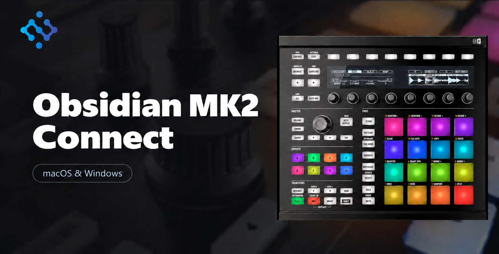

# Obsidian MK2 Connect

Connect your MK2 controller on macOS and Windows.

> [!CAUTION]
> **The Jam controller will not work while the MK2 is enabled.** Select **Restore original** to use Jam again.

This is an unofficial project. You need an installed and activated copy of the compatible version 3 software and the MK2 controller driver.

## macOS

1. Download the macOS ZIP from [Releases](../../releases) and extract it.
2. Close the music software and open **MK2 Activator**.
3. Click **Activate MK2** and enter your Mac administrator password.
4. Connect your MK2 and open the music software.

To undo the change, close the music software and select **Restore original**. If the activator cannot find a matching backup, repair the software using your software provider’s installer.

Requires macOS 11 or later and Python 3, available with the Xcode Command Line Tools. Tested with an MK2 on an Intel Mac running version 3.3.0. Apple Silicon hardware and other versions have not yet been tested with a controller; unsupported builds are refused.

## Windows

1. Download **MK2 Activator.exe** from [Releases](../../releases).
2. Close the music software and open the activator.
3. Click **Enable MK2**, then connect your MK2 and open the music software.

To undo the change, select **Restore original** or repair the software using your software provider’s installer. Windows 10 or 11 is required. Versions 3.6.0 and 3.7.1 have been analyzed and tested; other versions are only patched when the expected code is found.

**After updating the music software**, run the activator again.

---
An independent, unofficial project. Released under the [MIT License](LICENSE).
